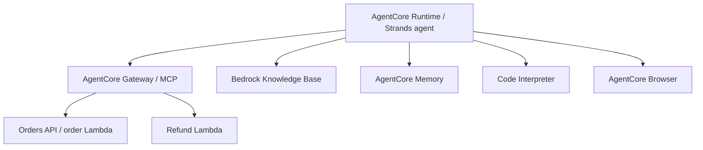

# Architecture and implementation notes

One Strands agent runs inside `BedrockAgentCoreApp`. The module-level application exposes an async `@app.entrypoint` function and starts through `app.run()`. The tested model is Amazon Nova 2 Lite through Bedrock; the final deployment uses a Python 3.13 ARM64 ZIP package.

## Tool routing and expected backends

The Gateway MCP connection signs requests with SigV4 using refreshed AWS credentials. `MCPClient` remains open throughout the invocation, and the application loads every page of Gateway tools before constructing the agent.

The original mock backends exposed these contracts. Their supplied course source is not included in this public project.

| Gateway tool | Arguments | Expected result |
| --- | --- | --- |
| `OrdersApi___get_order` | `order_id` | Order identity, customer identity, status, items, total and delivery/tracking fields |
| `OrdersApi___list_customer_orders` | `customer_id` | Customer identity and an `orders` list |
| `OrdersApi___get_customer` | `customer_id` | Name, loyalty points and tier |
| `RefundLambda___initiate_refund` | `order_id`, `reason`, `amount` | Refund identity, order identity, approved status and amount |
| `RefundLambda___check_refund_status` | `refund_id` | Refund identity, status and estimated processing time |
| `RefundLambda___get_return_label` | `order_id` | Order identity, label URL, carrier and expiry |

The API target maps GET routes `/orders/{order_id}`, `/customers/{customer_id}/orders` and `/customers/{customer_id}`. Its successful tool result contains the response JSON. The direct Lambda target receives its tool name through the `bedrockAgentCoreToolName` client-context field and returns a `statusCode` plus a JSON-encoded `body`. The agent's refund validation handles this envelope.

Tests assume `CUST-123` owns shipped `ORD-001` and delivered `ORD-002`, with the latter priced at $139.99. Product tests expect a Kindle Paperwhite entry stating `Waterproof: IPX8 rated`, a source named `product_catalog.txt`, and the corresponding demo return policy. These are fixture assumptions, not current retail facts. Changing the domain requires changing both reference data and test assertions.

## Grounding and transaction receipts

`search_knowledge_base` calls Retrieve for up to three passages, joins their text with source references and returns a descriptive message if `KB_ID` is missing. Instructions forbid adding specifications absent from retrieved material, such as interpreting a water-resistance rating as a particular depth or duration. This improves grounding; it is not a formal guarantee against every unsupported statement.

Before a refund, hooks require an order verified for the current customer, a reason and a positive amount no greater than the order total. Only one refund attempt per order is allowed within an invocation. After a successful refund, an `AfterInvocationEvent` hook validates the returned transaction fields and creates the final receipt. Its priority places it before memory persistence, so memory receives the validated answer. Refund approval does not imply that a return label was generated.

## Memory across and within sessions

These are separate paths:

- **Within a session:** load complete recent user/assistant pairs from Memory events for that customer and session. Retain at most six turns within the history character budget. This is bounded history, not conversation summarization.
- **Across sessions:** discover strategy namespaces through `namespaceTemplates` or legacy `namespaces`, query each customer-scoped namespace and prepend tagged records to the current user message. Semantic and preference extraction is asynchronous, so a saved event may not immediately appear in retrieval.

`MemoryHook` saves the original query and final answer only after a completed response. Retrieved context is treated as historical data and is not saved as part of the customer's original query. The recall test uses the same customer in two different Runtime sessions and checks that the second session has no loaded conversation history.

## Exact quotes and cleanup

The loyalty tool sends self-contained Python code to `code_session(REGION).invoke("executeCode", ...)` with `clearContext=True`, consumes its result inside the sandbox context and validates the JSON breakdown with Pydantic. Money uses Decimal arithmetic and half-up cent rounding.

Demo rules redeem points in 500-point blocks at 100 points per dollar, capped at 50% of the gross order. The tier discount follows redemption: Silver 0%, Gold 10% only for an entirely accessories order, Platinum 15%. Standard/device/Fresh earn rates are 1/2/5 points per final dollar, rounded down. The current tier is supplied rather than recalculated from the projected balance. Mixed baskets are outside this calculator's contract.

For Gold, 4,250 points and $150 of accessories at the standard earn rate, the sandbox returned 4,000 points redeemed, $99.00 due and a projected balance of 349 points. This is a quote, not a ledger update. If the sandbox fails, an explicitly marked fallback applies only the eligible tier discount; it neither redeems nor earns points and leaves the balance unchanged.

`ManagedAgentCoreBrowser` tracks its remote clients, uses a five-minute session lifetime and attempts shutdown in the invocation's `finally` block. Model/tool budgets, a cooperative deadline and bounded tool text limit resource use; they are not a hard currency budget.

## Production boundary and evidence

The demo accepts customer identity from the caller. Production must derive it from authentication and enforce ownership in the backend. Real refunds also need durable idempotency across retries and sessions; the in-memory invocation guard is insufficient. Debug output should be restricted and retained deliberately because it includes customer preferences and tool responses.

The [conversation evidence](../evidence/conversations.md) distinguishes final refund/RAG regressions from earlier order, memory, calculation and browser runs, and explains the browser's offline validation correction. Public evidence is redacted historical output, not a live service or a replayable raw-log fixture.
