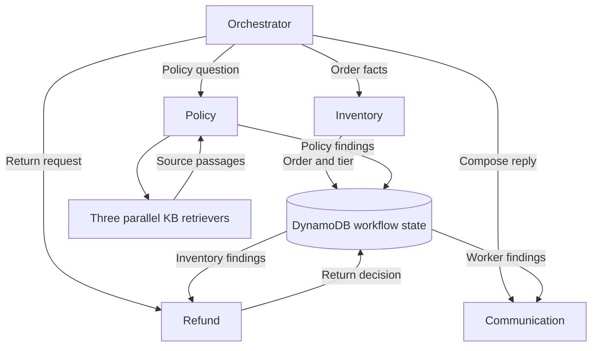

# NovaMart Multi-Agent E-commerce RAG

I built a support system for a fictional retailer that handles order lookups, return requests, policy questions and price calculations. A Strands agent running on Amazon Bedrock AgentCore routes each request to the workers it needs. A communication agent reads their findings from DynamoDB and writes the customer-facing reply.

This was my third project for **Future AWS Agent Engineer**. It passed Udacity review in November 2026 and earned **120/120** on the project test suite. [Udacity credential](https://www.udacity.com/certificate/e/ba4d35d2-900d-11f1-af8a-c3a2c0d02ae4).

## How requests move through the system

| Customer request | Route after session initialization | What the implementation does |
| --- | --- | --- |
| Return an order | Inventory → Refund → Communication | Inventory looks up the customer's order. Refund checks delivery and the tier-specific return window. A conditional DynamoDB write creates a return reference and lets a repeat request reuse it. |
| Ask about a policy | Policy → three parallel retrievers → Communication | Separate Bedrock knowledge bases hold returns, shipping and warranty documents. The policy agent collects source-labelled passages and records which lookup failed if a source is unavailable. |
| Calculate a total with a stated discount | Communication | The customer supplies the quantity, unit price and discount. The agent can answer without an order lookup or refund decision. |

The router uses Claude Haiku 4.5 and the specialist agents use Claude Sonnet 4.5. The router runs its tools sequentially so a refund can use the inventory result. Inside the policy worker, three retrievals can run at the same time. DynamoDB uses a version field for workflow updates. The communication worker's reply is bound to the current turn.

## What I verified in the lab

- The agent-construction checks earned **40/40**. The knowledge base checks earned **25/25** and returned passages from each policy's own S3 prefix.
- The first guardrail version treated a discount calculation as a price negotiation. I revised the denied topic to describe bargaining for a new price. Version 2 passed five live checks covering both sides of that distinction.
- Asked for the total for five items at $29.99 each with 10% off, the deployed runtime returned **$134.96** and emitted an X-Ray trace. The guardrail also blocked separate requests about competitor products and legal threats.

[Recorded test outcomes](evidence/results.json) · [Five-case guardrail check](verify_guardrail.py)

## Routing architecture

The router delegates individual steps and collects each worker's result. On a return request, inventory findings reach the refund worker through shared state. On a policy request, the policy worker gathers the three retrieval results before the router calls Communication. AWS X-Ray traced the worker calls and policy lookups in the lab.



## Inspect or run the implementation

[Student implementation](implementation.py) · [Starter integration](build_runtime.py) · [Udacity classroom starter at the tested revision](https://github.com/udacity/cd14764-aws-agentic-c3-classroom/tree/7ea65087dc014ac031daab3255b018346ab2d981/project/starter)

The Python implementation contains the five agent builders, the per-turn response handling, guardrail provisioning, deployment, session-memory configuration and observability settings. The integration script combines those functions with the classroom's own infrastructure and runtime helpers in a local checkout.

From this portfolio's root, the following commands assemble the runtime locally. This step uses Python's standard library and Git.

```bash
portfolio="$PWD/projects/03-novamart-multi-agent-rag"
classroom="$PWD/../novamart-classroom"
git clone https://github.com/udacity/cd14764-aws-agentic-c3-classroom.git "$classroom"
git -C "$classroom" checkout --detach 7ea65087dc014ac031daab3255b018346ab2d981
lab="$classroom/project/starter"
python "$portfolio/build_runtime.py" "$lab"
python -m py_compile "$lab/src/agent_orchestrator.py"
```

For a cloud run, use the pinned starter's setup instructions to install the dependencies, provision the foundation stack, seed the demo data and sync the three S3-backed knowledge bases. Enter your own resource IDs in the lab's local `.env`. From that prepared lab, run the deployment and save its runtime ARN and numbered guardrail settings to the same file before testing.

```bash
cd "$lab"
python src/agent_orchestrator.py deploy
# Save the deployment outputs in the local .env before running the checks.
python tests/test_agent.py all
cp "$portfolio/verify_guardrail.py" .
python verify_guardrail.py
python src/agent_orchestrator.py invoke 'How much are 5 items at $29.99 with 10% off?'
```

## Scope of the demo

The return worker records a request against a fictional order. Payment settlement would require a payment-provider integration. The lab accepts a customer identifier in the invocation payload. A customer-facing deployment would need an authenticated identity at that boundary.
